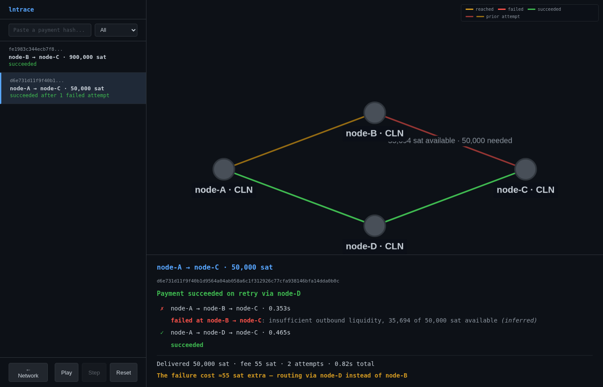
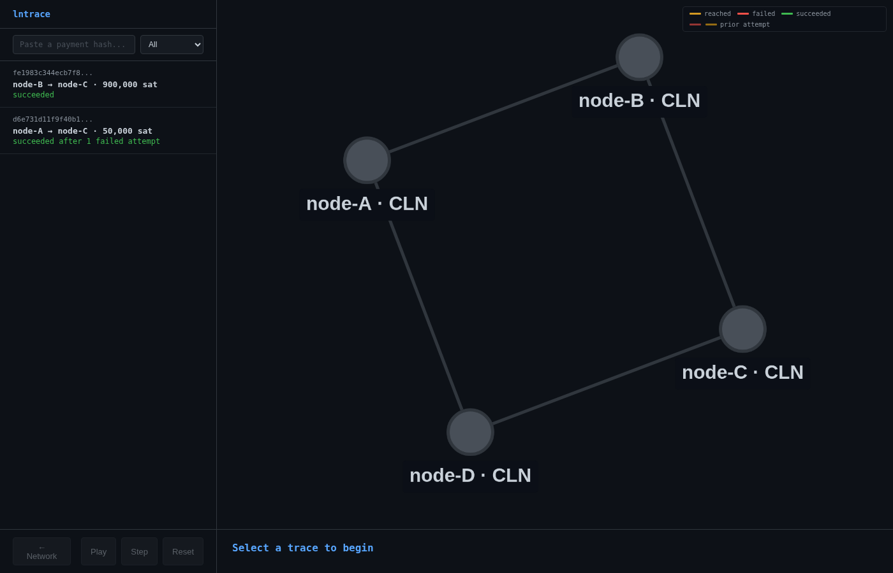
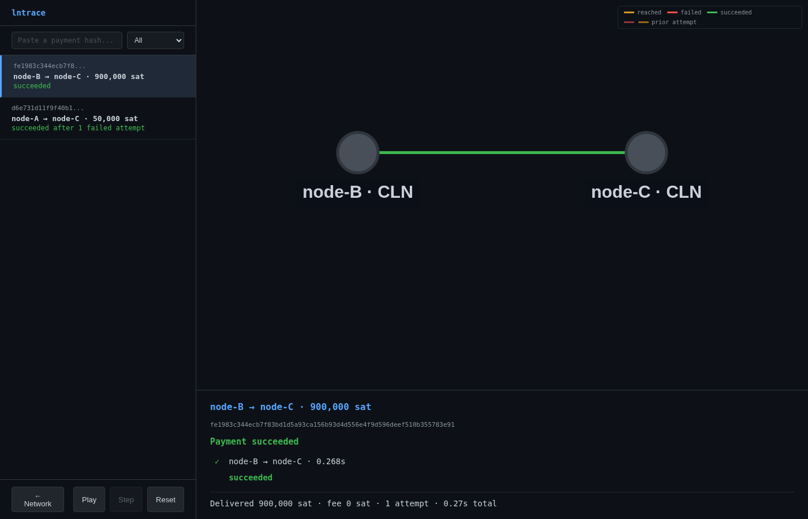

# lntrace

> Your Lightning node tells you *that* a payment failed. lntrace shows you *where* and *why*. The ability to trace what happens under the hood.

[](https://github.com/juliusjulyp/lntrace/actions/workflows/ci.yml)

When a multi-hop payment fails, the sender only gets a generic error such as
`temporary_channel_failure`. The real reason sits on another node. lntrace
collects events from every node it runs on, links them into one trace per
payment, and shows the failing hop, the likely cause with real numbers, and
any retries — including what they cost.


*Attempt 1 failed at node-B → node-C: 35,694 sat available, 50,000 needed. The retry via node-D succeeded and cost ≈54.5 sat more.*

Currently supports CLN, with LDK and LND adapters planned.

---

## Try it in 30 seconds (no nodes needed) but you can also use it in your application if need be instructions have also been provided

```bash
git clone https://github.com/juliusjulyp/lntrace
cd lntrace
cargo build
cargo run -p lntrace-cli -- ui --log fixtures/4node-reroute/
# open http://localhost:8080
```

---

## Requirements

- **Rust 1.75+** (stable). The codebase uses return-position `impl Trait` in traits (RPITIT), stabilised in 1.75.
- **CLN with xpay.** Payments must go through xpay to provide per-path route data (`pay_part_start`/`pay_part_end`). Tested on CLN v26.06.8.
- **Docker note:** a plugin built on the host may not run inside a CLN container if the C library versions differ. Until static release binaries exist, build the plugin inside a container that uses the same base image as your node (see `lab/Dockerfile.plugin` for an example).

---

## How it works

```
CLN node 1 ──→ lntrace-cln plugin ──→ raw JSONL ──┐
CLN node 2 ──→ lntrace-cln plugin ──→ raw JSONL ──┤
     ⋮                                              │
CLN node N ──→ lntrace-cln plugin ──→ raw JSONL ──┤
                                                    ▼
                                              translator
                                           (raw → TraceEvent)
                                                    │
                                              correlator
                                                    │
                                            traces + graph
                                                    │
                                        ┌───────────┴───────────┐
                                        ▼                       ▼
                                  CLI (replay)            UI (browser)
```

1. **The plugin** (`lntrace-cln`) runs on each node, subscribing to notifications and writing raw JSONL logs. It uses read-only RPCs (`getinfo`, `listpeerchannels`) but never initiates payments or modifies channels or wallets.
2. **The correlator** pairs each path attempt with its result by `(groupid, partid)`, merges forward events across nodes, and infers the actual cause of failures from channel state snapshots.
3. **The CLI and UI** consume the correlated traces. The replay UI renders the payment graph with route focus, step/play animation, and a summary panel showing the cost of retries.

See [docs/design.md](docs/design.md) for the event schema, capability matrix, and full architecture.

---

## Use with your own CLN nodes

Build the plugin and point your node at it:

```bash
cargo build -p lntrace-cln --release
```

Then either start lightningd with the plugin:

```bash
lightningd --plugin=/path/to/target/release/lntrace-cln
```

Or load it at runtime (options must be passed as key-value pairs):

```bash
lightning-cli plugin start /path/to/target/release/lntrace-cln
lightning-cli -k plugin subcommand=start plugin=/path/to/lntrace-cln lntrace-dir=/shared/logs
```

By default the plugin writes `lntrace-raw.jsonl` in the node's data directory. For multi-node setups, use `--lntrace-dir` to write all logs into one shared directory (each file is named by the node's alias):

```bash
lightningd --plugin=.../lntrace-cln --lntrace-dir=/shared/logs/
```

Or set an explicit path per node with `--lntrace-log=/path/to/file.jsonl`.

**Note:** with `--lntrace-dir`, filenames are the node's alias verbatim (e.g. `node-A.jsonl`). If two nodes share an alias, their logs will collide. Use `--lntrace-log` with distinct paths per node in that case.

To view traces, point the UI at the log directory (repeatable for multiple directories):

```bash
cargo run -p lntrace-cli -- ui --log /shared/logs/
cargo run -p lntrace-cli -- ui --log /shared/logs/ --follow   # live mode
```

---

## CLI commands

```bash
# decode a BOLT 4 failure code
cargo run -p lntrace-cli -- explain 0x1007

# list events from a fixture directory
cargo run -p lntrace-cli -- events --log fixtures/4node-reroute/

# show all payment traces
cargo run -p lntrace-cli -- replay fixtures/4node-reroute/

# trace a specific payment
cargo run -p lntrace-cli -- trace <payment_hash> --log fixtures/4node-reroute/

# launch the graph UI
cargo run -p lntrace-cli -- ui --log fixtures/4node-reroute/
```

---

## Screenshots

| Overview | Success trace |
|---|---|
|  |  |

---

## Status

 The replay UI, CLN plugin, correlator, and CLI are functional.

| Component | Status | Description |
|---|---|---|
| `lntrace` library | done | Types, JSONL collector, correlator, graph builder, BOLT 4 decoder |
| CLI | done | `events`, `trace`, `replay`, `explain`, `ui` subcommands |
| Replay UI | done | Cytoscape.js graph with fcose layout, route focus, search/filter, step/play animation, summary panel |
| CLN plugin | done | Records notifications and `listpeerchannels` snapshots as raw JSONL |
| CLN translation | done | Typed deserialization via `cln-rpc`, run centrally by the CLI |
| Correlator | done | Per-shard attempt pairing, direction-aware hop matching, cause inference from channel snapshots |
| Docker lab | done | 4-node diamond CLN v26.06.8 lab with success, reroute, and total-failure scenarios |

---

## Roadmap

| Milestone | Focus | Status |
|---|---|---|
| v0.1 | Core trace pipeline: CLN plugin, correlator, replay UI, live mode (`ui --follow`) | done |
| v0.2 | LDK adapter, MPP shard trees, OTel export, shareable traces | planned |
| v0.3 | LND adapter, scenario runner | planned |
| Future | Counterfactual replay, BOLT 12 tracing, channel jamming detection, LSPS | research |

---

## Known limitations

- **Visibility depends on which nodes you instrument.** For payments sent from an instrumented node, you see the full route and the failing hop, because the sender's node reports them. The cause of a failure can only be inferred if the failing node is also instrumented. For payments you only forward or receive, you see your own hop.
- **Causes are inferred, not reported.** When a hop fails with `temporary_channel_failure`, lntrace checks the failing node's channel state and infers the most likely cause (insufficient liquidity, HTLC minimum, too many HTLCs). The inference is usually right, but it's not authoritative.
- **CLN only (for now).** LDK and LND adapters are on the roadmap. LDK Node doesn't yet expose the events needed for full trace reconstruction.

---

## How it compares

| Tool | Focus |
|---|---|
| **Polar** | Visual regtest node management. Launches nodes; doesn't trace payments across them. |
| **SimLN** | Payment traffic simulator. Generates load; doesn't diagnose failures. |
| **RTL / ThunderHub** | Node dashboards. Show your own node's payments; don't correlate across hops. |
| **lntrace** | Cross-node payment tracing. Shows the full path, the failing hop, and the inferred cause. |

---

## The lab

A 4-node diamond topology for development and testing:

```
A ── B ── C
 \       /
  ── D ──
```

```bash
cd lab
docker compose up -d --build
bash fund-and-pay.sh          # opens channels, runs 3 scenarios, captures fixtures
docker compose down -v
```

For interactive testing after `fund-and-pay.sh`:

```bash
bash demo-pay                 # send a 50k sat payment from A to C
bash demo-drain               # drain B→C so payments reroute via D
bash demo-reset               # stop containers, remove volumes, clear logs
```

Note: `fund-and-pay.sh` leaves B→C and D→C drained after running all three scenarios. Use `demo-reset` to start fresh.

D's fees are raised so xpay prefers B when it has liquidity. Three scenarios are captured:

1. **Success** (`fixtures/4node-success/`): A pays C via B.
2. **Reroute** (`fixtures/4node-reroute/`): B→C drained, A pays C. Attempt 1 fails via B, xpay retries via D.
3. **Total failure** (`fixtures/4node-allfail/`): Both B→C and D→C drained. All attempts fail with inferred causes.

---

## Project structure

```
lntrace/
  crates/
    lntrace/               # library: types, collector, correlator, graph, BOLT 4 decoder
    lntrace-cli/           # CLI binary + graph UI server
  adapters/
    cln/                   # CLN plugin
  lab/                     # Docker regtest lab
  fixtures/                # recorded CLN notification data from regtest
```

---

## Security and privacy

- **Observe-only plugin.** The CLN plugin subscribes to notifications and uses read-only RPCs (`getinfo`, `listpeerchannels`) but never initiates payments or modifies channels or wallets. Like any CLN plugin, it runs with full access to the node's RPC socket; review the source if in doubt. Lab scripts (`fund-and-pay.sh`) do send payments, but those are test-harness actions, not part of the tool.
- **Local-first.** The UI server binds to localhost by default.

---

## Contributing

The CLN path has two parts: a **recorder** that writes raw notifications as JSONL (`adapters/cln/src/recorder.rs`), and a **translation module** that converts raw events into `TraceEvent` values (`adapters/cln/src/translate.rs`). The recorder runs as a CLN plugin on the node; translation runs centrally in the CLI when loading logs.

To add support for a new implementation (LDK, LND), write a recorder that captures the node's native events as JSONL, and a translation function from those events to `TraceEvent`. The `EventSource` trait in `crates/lntrace/src/source.rs` is the planned interface for push-based adapters that stream events directly instead of going through files.

---

